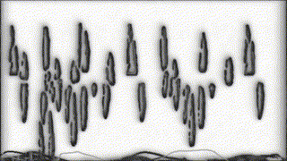
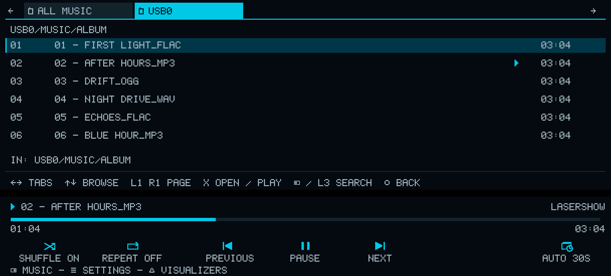
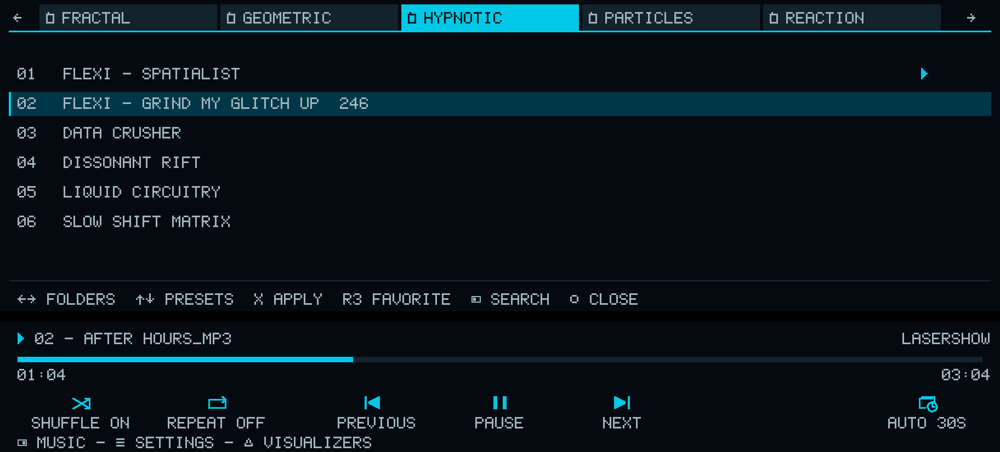

# HYPNOTIC

PS4 homebrew music player and audio visualizer.

## Visualizers

| Lasershow | Starz in Milk | Machine Code |
| :---: | :---: | :---: |
|  |  |  |

Short desktop projectM previews of included MilkDrop presets. PS4 appearance and performance can differ.

## App interface

| Music browser | Visualizer browser |
| :---: | :---: |
|  |  |

## Downloads

[Download releases](https://github.com/viktor23423512/HYPNOTIC/releases)

[0.84](https://github.com/viktor23423512/HYPNOTIC/releases/tag/v0.84) · [0.79](https://github.com/viktor23423512/HYPNOTIC/releases/tag/v0.79) · [0.77](https://github.com/viktor23423512/HYPNOTIC/releases/tag/v0.77) · [0.76](https://github.com/viktor23423512/HYPNOTIC/releases/tag/v0.76)

Development pre-releases. Download the `.pkg` from the release’s Assets section. Close HYPNOTIC before installing an update.

## Features

- USB playback: WAV, MP3, FLAC and Ogg Vorbis; mono/stereo, 8–48 kHz input.
- Folder browsing, filename search, shuffle, repeat and pressure-sensitive seeking.
- 10 built-in visualizers and 130 curated MilkDrop presets; additional `.milk` imports supported with compatibility limits.
- Mic Mode, saved visualizer Favorites/Recent, automatic preset cycling, Retro/Modern styles, nine colour palettes and six fonts.
- Saved volume/mute controls and a five-band audio equalizer; settings organized into Music, Visualizers, Theme and Misc tabs.
- 1080p default. Performance varies by preset; complex effects can run below 60 FPS.

## Source code

The 0.84 development source is published under [GPLv3](LICENSE), with [separate third-party notices](LICENSES/README.md).

[Browse the player source](graphics/) · [Download source ZIP](https://github.com/viktor23423512/HYPNOTIC/archive/refs/heads/main.zip)

Current source: **0.84**. Latest packaged release: **0.84**. See the [changelog](CHANGELOG.md) for changes in builds 0.80–0.84. Earlier release tags may predate their matching source publication; use the source asset attached to a release when provided.

Start with [build notes](docs/BUILDING.md) and [pinned dependencies](source-dependencies.json). This is a source snapshot; a clean-checkout build is not yet validated. The libjbc dependency is omitted pending license clarification, and toolchain binaries, sample music and community preset files are not included.

## Requirements

A homebrew-enabled PS4 with a working PKG installer. Compatibility with older firmware/GoldHEN versions is unverified.

Connect USB music before launching. To import presets, place `.milk` files in `HYPNOTIC/presets` on USB, then open **Visualizers → Imported → □ Rescan**. Some presets require additional textures or unsupported features.

## Controls

| Control | Action |
| --- | --- |
| Touchpad right / left click | Music / Search |
| OPTIONS | Settings, themes, fonts, credits and Mic Test |
| △ | Visualizer browser |
| D-pad / X / ○ | Browse / apply or play / back |
| L1 / R1 | Cycle presets; page tracks in Music |
| L2 / R2 | Pressure-sensitive backward / forward seek |
| □ in Music | Mic Mode |
| R3 in Visualizers | Favorite |
| L3 | Pin HUD; Search inside browsers |

If Remote Play does not supply touch coordinates, touchpad click opens Music; use L3 in a browser for Search.

[Setup](docs/GETTING_STARTED.md) · [Full controls](docs/CONTROLS.md) · [Credits](docs/CREDITS.md) · [Report a bug](https://github.com/viktor23423512/HYPNOTIC/issues/new/choose)

