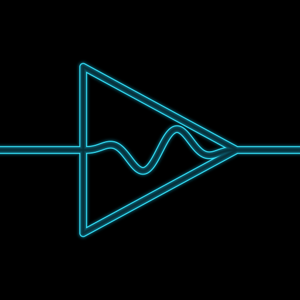
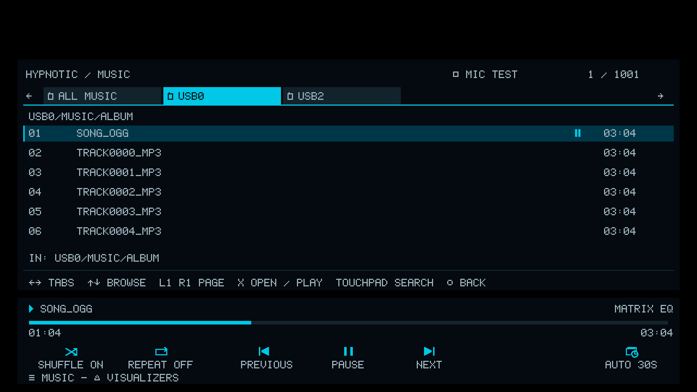

<p align="center">
  
</p>

<h1 align="center">HYPNOTIC</h1>
<p align="center"><strong>A standalone homebrew music player and audio-reactive visualizer for PS4.</strong></p>

<p align="center">
  <a href="#downloads">Downloads</a> · <a href="docs/GETTING_STARTED.md">Getting started</a> · <a href="docs/CONTROLS.md">Controls</a> · <a href="https://github.com/viktor23423512/HYPNOTIC/issues">Report a bug</a>
</p>

---

## What is HYPNOTIC?

HYPNOTIC plays music from USB storage and turns it into fullscreen, music-reactive visuals. Features: folder-based music browser, a playback HUD, 100+ built-in visualizers, and experimental MilkDrop preset support.

**Status: in development.** The current development build is **0.75**. Its new Cube Orbit EQ and settings menus still need PS4 testing. Earlier player and visualizer builds have been tested on PS4; this is not a finished stable release.

## Features

- **USB music playback:** WAV, MP3, FLAC, and Ogg Vorbis, with automatic sample-rate conversion for supported files.
- **Music browsing:** All Music and USB drive tabs, folders, filename search, track durations, and held-button scrolling.
- **Playback controls:** pause/resume fades, previous/next track, pressure-sensitive scrubbing, shuffle, and repeat.
- **A clean playback HUD:** track and visualizer names, progress bar, transport buttons, and automatic hiding during playback.
- **Visualizer selection:** folder tabs, saved Favorites and Recent lists, and timed automatic preset cycling.
- **Ten built-in visualizers** alongside experimental MilkDrop preset imports.
- **1080p by default.** Performance depends on the preset; complex MilkDrop effects can run below 60 FPS.

## 100+ preloaded visualizers


### Development previews

These images are captured from the production UI/geometry render tests, rather than photographs of the PS4 output. Final console appearance and performance may differ.

**Cube Orbit EQ**


**Music browser and playback HUD**



## MilkDrop presets

HYPNOTIC has an experimental native MilkDrop renderer using projectM's equation parser and evaluator, with a PS4 graphics adapter. The development build contains a curated selection of 130 presets across ten categories.

You can also add `.milk` files under:

```text
USB drive/
└── HYPNOTIC/
    └── presets/
        └── your-preset.milk
```

Open **Visualizers → Imported**, then press **□** to rescan. Compatibility varies: unsupported features display an error while retaining the current preset. Full compatibility with every MilkDrop preset is not claimed. [Import guide](docs/GETTING_STARTED.md#importing-milkdrop-presets)

## Downloads

**No public PKG release has been uploaded yet.** Public downloads will appear in [GitHub Releases](https://github.com/viktor23423512/HYPNOTIC/releases) when ready.

The repository currently serves as the project page, documentation, and issue tracker.

## Getting started

HYPNOTIC requires a homebrew-enabled PS4 capable of launching homebrew PKGs. Compatibility with older firmware and GoldHEN versions has not been verified. There is no confirmed minimum firmware version yet.

When a public package is available:

1. Download the PKG from this repository's Releases page.
2. Close HYPNOTIC before installing or updating it with your package installer.
3. Put supported music on USB storage, connect it before launch, and open HYPNOTIC.
4. Choose a song in Music, then press **△** to browse visualizers and **X** to apply one.

[Full setup and supported formats](docs/GETTING_STARTED.md)

## Main controls

| Control | Action |
| --- | --- |
| OPTIONS | Open / close Music |
| △ | Open / close Visualizers |
| D-pad | Browse rows and switch tabs; hold to scroll |
| X | Open / play / apply the selected item; activate the selected HUD button |
| ○ | Back / close |
| L2 / R2 | Scrub backward / forward; more pressure moves faster |
| L1 / R1 | Cycle presets while viewing; page tracks in Music |
| Touchpad | Search in the music or visualizer browser |
| R3 | Toggle a favorite in the visualizer selector |
| L3 | Pin / unpin the playback HUD |
| □ | Context controls, including Cymatics and Cube Orbit settings |

[Complete controls and settings](docs/CONTROLS.md)

## Feedback

Found a problem? [Open an issue](https://github.com/viktor23423512/HYPNOTIC/issues/new/choose) with the app version, PS4 model, firmware/GoldHEN version, preset or audio format, and steps to reproduce it. Screenshots help; remove personal information before sharing logs.

## Credits

HYPNOTIC builds on work by OpenOrbis and the PS4 homebrew community, Ryan Geiss and projectM contributors, the Cream of the Crop preset artists, OpenGNM/Mesa, glslang, HLSLParser, dr_libs, stb, and libjbc.

[Credits and attribution](docs/CREDITS.md) · [Development plans](docs/ROADMAP.md)
